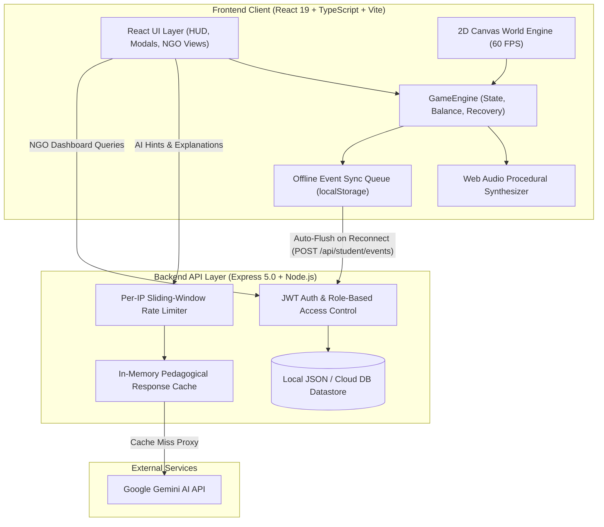

<div align="center">

# 🪙 MoneyQuest (धनखोज / మనీక్వెస్ట్)
### *A Retro 2D Financial Literacy RPG & Multi-Tenant NGO Impact Analytics Platform*

[](https://www.typescriptlang.org/)
[](https://react.dev/)
[](https://vitejs.dev/)
[](https://expressjs.com/)
[](https://developer.mozilla.org/en-US/docs/Web/API/Web_Audio_API)
[](https://ai.google.dev/)
[](tests/)
[](LICENSE)

*Empowering students and first-generation earners across Tier-2 and Tier-3 communities to master real-world financial decision-making through immersive pixel-art adventure, multi-language pedagogy, and real-time educator analytics.*

---

[Key Features](#-key-features) • [Architecture](#-system-architecture) • [Gameplay & The 4 Pillars](#-gameplay--the-4-financial-pillars) • [Engine Highlights](#-custom-game-engine-highlights) • [Testing & Security](#-testing--security-enforcement) • [Quickstart](#-quickstart--local-development)

---

</div>

## 📌 Executive Summary

Financial illiteracy in developing economies often leads young adults, students, and first-time earners into high-interest debt traps, predatory digital lending apps, and cyber fraud scams. Traditional financial education fails because it is abstract, lecture-based, and disconnected from daily pressures.

**MoneyQuest** transforms financial pedagogy into an exploratory **2D top-down retro RPG**. Players step into the shoes of a college student navigating independent life across four distinct regional Indian districts. Every decision—from choosing between an informal peer loan vs. a formal bank recurring deposit, to identifying a UPI phishing trap—dynamically impacts the player's wallet balance, emergency reserve, and financial confidence score.

The platform is built with an **offline-first hybrid architecture**: it runs 100% locally in low-connectivity classrooms while offering live AI mentoring via Google Gemini, synchronized offline telemetry queues, and a multi-tenant analytics dashboard for NGO educators.

---

## 🌟 Key Features

| Feature | Description |
| :--- | :--- |
| **🎮 Custom 2D Canvas Engine** | Built from scratch with HTML5 Canvas, zero heavy game engine dependencies. Features spatial grid collision, sub-pixel wall sliding, corner assist, and smooth Lerp camera tracking. |
| **🔊 Procedural 8-Bit Web Audio** | 100% synthesized retro sound effects and ambient chiptunes generated on the fly via the Web Audio API—zero MP3/WAV asset downloads required. |
| **🏛️ 4 Regional Financial Pillars** | Curated scenarios spanning Budgeting, Formal Banking, Investment & Compounding, and Cyber Fraud / Insurance. |
| **🗣️ Tri-Lingual Localization** | Complete real-time language switching across **English**, **Hindi (हिंदी)**, and **Telugu (తెలుగు)** for scenarios, idea cards, and dialogues. |
| **🤖 Contextual AI Mentorship** | Adaptive hint generation and pedagogical decision breakdowns powered by Google Gemini with in-memory caching and offline heuristic fallback. |
| **📊 Multi-Tenant NGO Dashboard** | Strict organizational tenant segregation enabling educators and field coordinators to track cohort pass rates, common trap pitfalls, and student progress timelines. |
| **🛡️ Recovery & Anti-Frustration** | Built-in financial recovery mechanics and scholarship relief grants if a player reaches bankruptcy, turning failures into educational breakthroughs. |
| **📦 Optimized Production Bundle** | Manual Vite Rollup chunk splitting cutting initial JS bundle payload by **>70%** ($339\text{ kB}$ main bundle) for fast loading on 3G/4G networks. |

---

## 🏗️ System Architecture



---

## 🗺️ Gameplay & The 4 Financial Pillars

The world of MoneyQuest is divided into four interconnected, uniquely themed Indian regional districts representing core financial milestones:

### 🏙️ City 1: Campus District — Budgeting & Living Essentials
- **Themes**: Monthly stipend budgeting, distinguishing needs vs. wants, food and transport trade-offs, establishing an initial emergency cushion.
- **Key Characters**: Tea Vendor, Student Friend, Hostel Warden.
- **Core Concept**: Preventing end-of-month cash shortages through envelope budgeting and baseline emergency buffers.

### 🏛️ City 2: Town Center — Banking, Savings & Formal Credit
- **Themes**: Opening formal zero-balance bank accounts, postal savings, recurring deposits (RD), and avoiding predatory local loan sharks.
- **Key Characters**: Post Office Teller, Anand the Merchant, Cycle Mechanic.
- **Core Concept**: Understanding annual percentage interest, compounding in formal deposits, and why informal debt traps destroy wealth.

### 📈 City 3: Riverside Market — Investments & Inflation Protection
- **Themes**: Demat accounts, mutual fund SIPs, gold vs. equity index funds, beating inflation over long horizons.
- **Key Characters**: Dock Master, Fishmonger, Bookshop Keeper.
- **Core Concept**: Protecting purchasing power against inflation through diversified, disciplined, long-term asset allocation.

### 🛡️ City 4: Cyber & Technology Hub — Fraud Prevention & Insurance
- **Themes**: Identifying fake UPI QR codes, phishing calls, ATM skimmers, health vs. term insurance policies.
- **Key Characters**: Repair Tech, Museum Curator, Groundskeeper.
- **Core Concept**: Preserving hard-earned savings against social engineering scams and catastrophic health expenditure.

---

## ⚙️ Custom Game Engine Highlights

MoneyQuest uses a custom-crafted 2D world engine designed specifically for top-down retro pixel art games:

### 1. 8x8 Spatial Partitioning Collision Grid
Rather than iterating through hundreds of collision hitboxes every frame ($O(N)$), the map is partitioned into an $8 \times 8$ uniform spatial cell grid. Collision queries execute in $O(1)$ time by testing only candidate obstacles in overlapping cells.

### 2. Sub-Pixel Continuous Wall Sliding
When a player moves diagonally against a wall or barrier, the engine projects velocities independently along cardinal axes. If an obstacle blocks horizontal movement, the remaining vertical velocity is preserved seamlessly flush against the wall without sticking or penetrating boundaries.

### 3. Corner-Assist Nudging
To eliminate the frustrating "micro-snag" when players turn around narrow gate posts and alley corners, the engine checks for near-miss obstacles within 6 pixels and automatically nudges the character around the corner into open paths.

### 4. Foot-Aligned Hitboxes
True to retro RPG conventions, character collision boxes are anchored to the lower $35\%$ of the sprite (feet), allowing character heads and torsos to naturally overlap background trees, fences, and building canopies for depth perspective.

---

## 🎵 Procedural 8-Bit Web Audio Engine

To keep the game lightweight and instantly playable on low-bandwidth connections, MoneyQuest features a complete procedural sound engine built with the **Web Audio API**:
- **Dialogue Voice Blips**: Dynamic frequency-ramped triangle-wave blips generated at $24\text{ ms}$ intervals during typewriter streaming. Voice frequencies adapt to character roles (e.g. students speak at higher pitches; security guards and wardens speak at deeper tones).
- **Decision Audio Feedback**:
  - **Success / Best Tier**: Rewarding 4-note ascending major arpeggio ($C5 \to E5 \to G5 \to C6$).
  - **Financial Trap / Warning**: Dissonant descending sawtooth buzzer ($240\text{ Hz} \to 130\text{ Hz}$).
  - **Mentor Hint**: Shimmering mystical 3-tone chime ($A5 \to D6 \to E6$).
  - **Coin & Stipend**: Crisp 2-tone sine chime ($B5 \to E6$).
- **Ambient Chiptune Arpeggiator**: Background adventure loop generated rhythmically through synchronized sine oscillators.
- **Zero Asset Overhead**: Requires $0\text{ MB}$ of external audio assets.

---

## 🧪 Testing & Security Enforcement

The platform maintains high engineering standards with comprehensive automated test suites covering integration, security, and game physics:

```bash
# Run all automated test suites
npm test && npx tsx tests/city1World.test.ts
```

### 1. Integration Engine Suite (`tests/integration.test.ts` — 9/9 Passed)
- Multi-quest completion logic and inter-city transition unlocks.
- Browser reload determinism (accurately resumes exact coordinates and unlocked states).
- In-game bankruptcy reset mechanics (safely grants ₹5,000 scholarship relief).
- Full 4-pillar game completion and graduation state verification.

### 2. Authentication & Access Control Suite (`tests/auth_and_separation.test.ts` — 10/10 Passed)
- JWT token authentication and student session generation.
- Cross-student data tampering prevention (rejects attempts to modify or inspect another student's wallet/events).
- **Strict NGO Tenant Separation**: NGO staff are restricted to viewing students only within their assigned organization; cross-organization requests return `403 Forbidden`.
- Role-based route guards rejecting unauthenticated requests.

### 3. World Engine & Map Physics Suite (`tests/city1World.test.ts` — 14/14 Passed)
- Spawn coordinate collision clearance and solid boundary enforcement.
- Strict 4-way cardinal movement with diagonal drift prevention.
- Viewport camera clamp calculations.
- BFS path reachability verifying that all 12 destination points and city exits are reachable from spawn.
- Continuous sub-pixel wall sliding and gate corner-assist validation.
- Disk verification of pixel art spritesheets and directional animation cadence.

---

## 📂 Project Structure

```text
megathon26-anything/
├── server/                    # Express backend proxy & telemetry server
│   ├── index.ts               # REST API, rate limiting, JWT auth, AI caching
│   └── data/database.json     # Data persistence store
├── src/
│   ├── assets/                # Pixel art maps, character & NPC spritesheets
│   ├── components/
│   │   ├── ai/                # AI feedback cards & mentor explanation components
│   │   ├── gameplay/          # Puzzle modals, MCQ scenarios, idea cards
│   │   ├── ngo/               # NGO educator impact analytics dashboard
│   │   ├── ui/                # HUD navbar, procedural audio synthesizer
│   │   └── world/             # 2D Canvas engine, NPC dialogue modals
│   ├── data/
│   │   ├── maps/              # City 1-4 obstacle bounds, portals, NPC coordinates
│   │   └── puzzles.ts         # Complete curriculum scenarios across all 4 pillars
│   ├── engine/
│   │   ├── eventLogger.ts     # Offline-first telemetry queue & auto-sync
│   │   ├── gameEngine.ts      # Financial calculations, scoring & state transitions
│   │   └── storage.ts         # LocalStorage persistence & bankruptcy relief
│   ├── services/
│   │   └── aiService.ts       # Gemini API client with offline heuristic fallback
│   └── types/                 # Shared TypeScript interfaces & models
├── tests/                     # Automated integration, security, & world test suites
├── vite.config.ts             # Vite config with manual chunk splitting
└── package.json
```

---

## 🚀 Quickstart & Local Development

### Prerequisites
- **Node.js**: v18.0.0 or higher
- **npm**: v9.0.0 or higher

### 1. Installation
```bash
git clone https://github.com/Neshanth-Yalamaddi/moneyquest.git
cd moneyquest
npm install
```

### 2. Environment Configuration (Optional)
Create a `.env` file in the project root:
```env
PORT=3001
GEMINI_API_KEY=your_gemini_api_key_here
```
> [!NOTE]
> The game includes a complete built-in offline educational fallback engine. You can run and play the entire game locally even without an internet connection or Gemini API key.

### 3. Running the Application
In separate terminal tabs, launch the frontend and backend servers:

```bash
# Terminal 1: Start Frontend Dev Server (Vite)
npm run dev

# Terminal 2: Start Backend API Server (Express + tsx)
npm run server
```

Open your browser at `http://localhost:3000` (or the port specified in terminal output).

### 4. Running Test Suites
```bash
# Run core integration and security tests
npm test

# Run the 2D world engine and collision physics tests
npx tsx tests/city1World.test.ts
```

### 5. Production Build
```bash
npm run build
npm run preview
```

---

## 👥 Target Audience & Social Impact

- **First-Generation College Students**: Learn to budget monthly allowances, avoid predatory debt apps, and protect against hostel scams.
- **Young Vocational Earners**: Understand bank accounts, recurring savings, and formal investment avenues.
- **NGOs & Rural Educators**: Use the built-in analytics dashboard to measure student comprehension, diagnose common financial misconceptions, and evaluate learning outcomes across cohorts.

---

## 📄 License
This project is licensed under the [ISC License](LICENSE).
